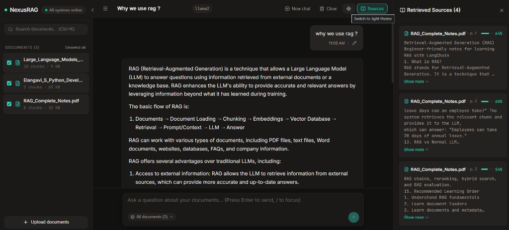
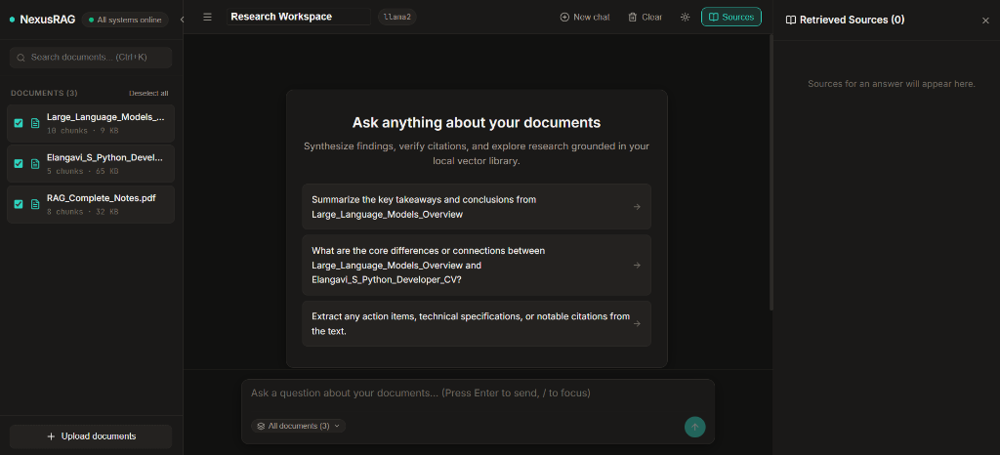
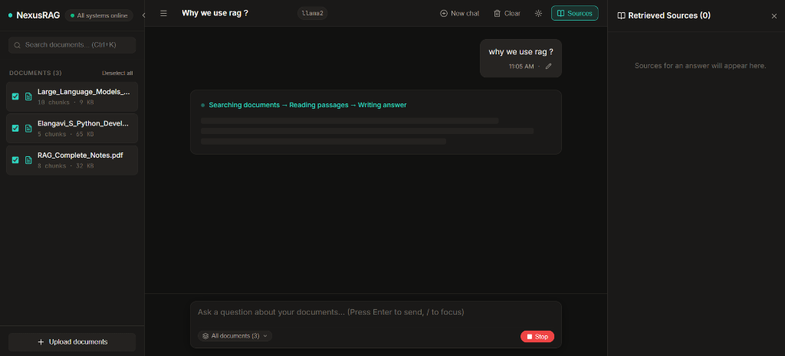

# NexusRAG — End-to-End RAG Chatbot

An enterprise-grade, locally running Retrieval-Augmented Generation (RAG) chatbot application built with **FastAPI**, **ChromaDB**, **Ollama (Llama 2 & Nomic Embed Text)**, **LangChain**, and **React (Vite)**.

NexusRAG enables users to upload PDF and TXT documents, chunk and index them into persistent vector storage, and query them with natural language questions. Responses are generated strictly from retrieved document excerpts using a local Llama 2 model, complete with source citations, page numbers, and similarity scores.

---

## 📸 Interface & Live Demo Showcase

### 💬 Interactive RAG Workspace & Grounded Sources
> Natural language query grounded strictly against selected documents, featuring retrieved source passages with similarity match scores, page citations, and inline query editing.



<details>
<summary><b>🔍 Click to view additional workflow interfaces (Welcome Hub & Real-Time Reasoning)</b></summary>

<br>

#### 1. Multi-Document Knowledge Base & Exploration Hub
> Document library rail displaying indexed chunk counts, file sizes, bulk selection, and dynamically populated starter questions.



#### 2. Live Reasoning & Thought Progression
> Real-time pipeline step indicator (`Searching documents` → `Reading passages` → `Writing answer`) with instant generation cancellation.



</details>

---

## 1. System Architecture & Data Flow

```mermaid
flowchart TD
    subgraph Frontend["React Frontend (Vite)"]
        UI[Document Upload & Chat Interface]
    end

    subgraph Backend["FastAPI Backend Server (:8000)"]
        API[API Endpoints: /documents, /chat, /health]
        DP[Document Processor: PyPDF & RecursiveTextSplitter]
        RS[Retrieval Service & Prompt Synthesizer]
    end

    subgraph VectorDB["ChromaDB Vector Store (Persistent)"]
        Coll[(Collection: rag_knowledge_base)]
    end

    subgraph LocalOllama["Ollama Local Inference Server (:11434)"]
        EmbedModel[nomic-embed-text (768d)]
        LLM[Llama 2 (7B)]
    end

    %% Ingestion Pipeline
    UI -->|1. Upload PDF / TXT| API
    API -->|2. Validate & Extract Text| DP
    DP -->|3. Split Chunks (800 chars / 150 overlap)| DP
    DP -->|4. Generate Embeddings| EmbedModel
    EmbedModel -->|5. Store Embeddings + Metadata| Coll

    %% Retrieval & Generation Pipeline
    UI -->|6. Ask Question| API
    API -->|7. Embed Query| EmbedModel
    EmbedModel -->|8. Cosine Similarity Search| Coll
    Coll -->|9. Top-K Chunks + Page #| RS
    RS -->|10. Synthesize Grounded Prompt| LLM
    LLM -->|11. Generate Answer| RS
    RS -->|12. Return Answer + Source Citations| UI
```

---

## 2. Technology Stack

### Backend
- **Python 3.9+ / 3.14**: Core backend language
- **FastAPI**: Modern, asynchronous web framework for RESTful APIs
- **Uvicorn**: High-performance ASGI server
- **LangChain & LangChain-Chroma & LangChain-Ollama**: RAG orchestration and vector store integrations
- **PyPDF**: PDF text and page-by-page metadata extraction
- **Pydantic & Pydantic-Settings**: Request/response validation and environment configuration
- **ChromaDB**: Lightweight, local persistent vector database

### Local AI Inference
- **Ollama**: Local model execution engine
- **Llama 2 (7B)**: Language model for grounded response generation
- **nomic-embed-text**: 768-dimensional Ollama-compatible embedding model

### Frontend
- **React 19**: Interactive component UI
- **Vite 8**: Ultra-fast build tool and development server
- **Lucide React**: Clean vector iconography
- **Vanilla CSS**: Custom glassmorphism design system, dark mode, responsive layout

---

## 3. Project Directory Structure

```text
Rag_projets/
├── backend/
│   ├── app/
│   │   ├── __init__.py
│   │   ├── main.py                     # FastAPI app, lifespan, CORS, error handling
│   │   ├── config.py                   # Pydantic BaseSettings (.env loader)
│   │   ├── api/
│   │   │   ├── __init__.py
│   │   │   ├── health.py               # /health and /health/ollama endpoints
│   │   │   ├── documents.py            # /documents/upload, list, and delete
│   │   │   └── chat.py                 # /chat RAG query endpoint
│   │   ├── services/
│   │   │   ├── __init__.py
│   │   │   ├── document_processor.py   # Text extraction and Recursive splitter
│   │   │   ├── embedding_service.py    # Ollama embeddings wrapper
│   │   │   ├── vector_store.py         # Persistent ChromaDB client & operations
│   │   │   ├── retrieval_service.py    # Cosine similarity search & sources builder
│   │   │   ├── rag_service.py          # Grounded prompt engineering & pipeline
│   │   │   └── ollama_service.py       # Ollama LLM client & health checker
│   │   ├── schemas/
│   │   │   ├── __init__.py
│   │   │   ├── chat.py                 # ChatRequest, ChatResponse, SourceReference
│   │   │   └── document.py             # DocumentInfo, DocumentUploadResponse, etc.
│   │   └── utils/
│   │       ├── __init__.py
│   │       └── file_validation.py      # Extension, size, sanitization, SHA256 ID
│   ├── data/
│   │   ├── chroma/                     # ChromaDB persistent SQLite & vector files
│   │   └── uploads/                    # Local storage for uploaded files
│   ├── requirements.txt                # Exact, compatible Python packages
│   ├── .env.example                    # Template environment variables
│   └── .env                            # Active configuration
├── frontend/
│   ├── src/
│   │   ├── components/
│   │   │   ├── ChatWindow.jsx          # Header, message scroll, suggested queries
│   │   │   ├── ChatMessage.jsx         # User & assistant bubbles, metadata
│   │   │   ├── ChatInput.jsx           # Auto-resizing textarea with Enter to submit
│   │   │   ├── DocumentUpload.jsx      # Drag-and-drop dropzone with validation
│   │   │   ├── DocumentList.jsx        # Document cards, chunk counts, delete action
│   │   │   └── SourceReferences.jsx    # Collapsible source citations & excerpts
│   │   ├── services/
│   │   │   └── api.js                  # Frontend API client
│   │   ├── App.jsx                     # Top-level state and sidebar layout
│   │   ├── main.jsx                    # React DOM root entry
│   │   └── index.css                   # Glassmorphic dark design system
│   ├── package.json
│   ├── vite.config.js
│   └── index.html
├── docs/
│   └── images/
│       ├── nexusrag-demo-chat.png      # Interactive chat & source reference panel
│       ├── nexusrag-welcome.png        # Knowledge base & starter prompts overview
│       └── nexusrag-streaming-step.png # Real-time pipeline thought indicator
├── .gitignore
└── README.md
```

---

## 4. Prerequisites

1. **Python**: Version 3.9 or higher (Python 3.9, 3.10, 3.11, 3.12, 3.14).
2. **Node.js**: Version 18 or higher (with `npm`).
3. **Ollama**: Installed from [ollama.ai](https://ollama.ai) and running locally.

---

## 5. Ollama Setup & Model Pull Commands

Before launching the backend, start Ollama and download the required models:

```bash
# 1. Start Ollama (if not already running as a Windows service)
ollama serve

# 2. Pull the Llama 2 generation model (approx 3.8 GB)
ollama pull llama2

# 3. Pull the Nomic Embed Text embedding model (approx 274 MB)
ollama pull nomic-embed-text

# 4. Verify installed models
ollama list
```

> **Why separate models?**
> - `nomic-embed-text` converts document passages and questions into compact 768-dimensional numerical vectors optimized for semantic similarity search.
> - `llama2` is the generative autoregressive LLM that reads the retrieved context and formulates natural language answers.

---

## 6. Installation & Environment Setup

### A. Backend Setup

```bash
# 1. Navigate to the backend directory
cd d:/Rag_projets/rag-chatbot/backend

# 2. Create a virtual environment (Windows PowerShell)
python -m venv venv

# 3. Activate the virtual environment
.\venv\Scripts\Activate.ps1
# (or in CMD: .\venv\Scripts\activate.bat)

# 4. Install backend dependencies
pip install -r requirements.txt

# 5. Verify .env configuration (defaults are pre-configured)
# Copy from .env.example if needed:
# cp .env.example .env
```

### B. Frontend Setup

```bash
# 1. Navigate to the frontend directory
cd d:/Rag_projets/rag-chatbot/frontend

# 2. Install npm dependencies
npm install
```

---

## 7. Starting the Application

Open two terminal windows:

### Terminal 1: Backend Server (FastAPI)
```bash
cd d:/Rag_projets/rag-chatbot/backend
.\venv\Scripts\uvicorn.exe app.main:app --host 127.0.0.1 --port 8000 --reload
```
- **Backend API**: `http://127.0.0.1:8000`
- **Interactive Swagger Docs**: `http://127.0.0.1:8000/docs`
- **ReDoc**: `http://127.0.0.1:8000/redoc`

### Terminal 2: Frontend Server (React + Vite)
```bash
cd d:/Rag_projets/rag-chatbot/frontend
npm run dev
```
- **Web Interface**: `http://127.0.0.1:5173`

---

## 8. Configuration Reference (`.env`)

| Variable | Default Value | Description |
| :--- | :--- | :--- |
| `HOST` | `127.0.0.1` | Host address to bind the FastAPI server |
| `PORT` | `8000` | Port for the FastAPI server |
| `OLLAMA_BASE_URL` | `http://localhost:11434` | URL of the local Ollama daemon |
| `LLM_MODEL` | `llama2` | Model name for chat completion in Ollama |
| `EMBEDDING_MODEL`| `nomic-embed-text` | Model name for vector embeddings |
| `CHROMA_PERSIST_DIRECTORY` | `./data/chroma` | Local directory where ChromaDB stores SQLite & HNSW index |
| `CHROMA_COLLECTION_NAME` | `rag_knowledge_base` | Dedicated vector collection name |
| `UPLOAD_DIRECTORY` | `./data/uploads` | Path where uploaded original files are saved |
| `CHUNK_SIZE` | `800` | Maximum character length of each chunk |
| `CHUNK_OVERLAP` | `150` | Character overlap between consecutive chunks to retain context |
| `MAX_FILE_SIZE_MB` | `15` | Maximum upload size per file |
| `ALLOWED_EXTENSIONS` | `pdf,txt,docx` | Allowed file formats |
| `TOP_K_RESULTS` | `4` | Number of most relevant chunks retrieved per query |
| `CORS_ORIGINS` | `http://localhost:5173,http://127.0.0.1:5173` | Allowed frontend origins for CORS |

### Why Chunk Size and Overlap Matter:
- **Chunk Size (800)**: Chunks that are too large dilute semantic focus; chunks that are too small split coherent explanations across boundaries. 800 characters provides 2-3 focused paragraphs.
- **Chunk Overlap (150)**: Overlapping guarantees that terms and sentence structures situated at chunk boundaries are not sliced apart, preserving vital semantic context for retrieval.

---

## 9. API Reference & Sample Requests

### 1. Health Checks
#### `GET /health`
```bash
curl http://127.0.0.1:8000/health
```
```json
{
  "status": "healthy",
  "service": "rag-chatbot-backend",
  "timestamp": "2026-10-13T15:56:41.793391",
  "vector_db": {
    "status": "connected",
    "collection": "rag_knowledge_base",
    "total_indexed_chunks": 2
  }
}
```

#### `GET /health/ollama`
```bash
curl http://127.0.0.1:8000/health/ollama
```
```json
{
  "status": "ok",
  "connected": true,
  "base_url": "http://localhost:11434",
  "llm_model": "llama2",
  "llm_installed": true,
  "embedding_model": "nomic-embed-text",
  "embedding_installed": true,
  "installed_models": ["nomic-embed-text:latest", "llama2:latest"]
}
```

### 2. Document Management
#### `POST /documents/upload`
Uploads a document via `multipart/form-data`:
```bash
curl -X POST -F "file=@sample_ai_architecture.pdf" http://127.0.0.1:8000/documents/upload
```
```json
{
  "message": "Successfully indexed 'sample_ai_architecture.pdf' into 2 vector chunks.",
  "document": {
    "document_id": "21c7b7a317433761",
    "filename": "sample_ai_architecture.pdf",
    "file_type": ".pdf",
    "file_size_bytes": 2681,
    "chunk_count": 2,
    "uploaded_at": "2026-10-13T16:04:18.448330"
  }
}
```

#### `GET /documents`
```bash
curl http://127.0.0.1:8000/documents
```
```json
{
  "documents": [
    {
      "document_id": "21c7b7a317433761",
      "filename": "sample_ai_architecture.pdf",
      "file_type": ".pdf",
      "file_size_bytes": 2681,
      "chunk_count": 2,
      "uploaded_at": "2026-10-13T16:04:18.448330"
    }
  ],
  "total_documents": 1,
  "total_chunks": 2
}
```

#### `DELETE /documents/{document_id}`
```bash
curl -X DELETE http://127.0.0.1:8000/documents/21c7b7a317433761
```
```json
{
  "message": "Document '21c7b7a317433761' and all associated chunks were successfully deleted.",
  "document_id": "21c7b7a317433761",
  "deleted_chunks_count": 2
}
```

### 3. RAG Chat
#### `POST /chat`
```bash
curl -X POST http://127.0.0.1:8000/chat \
  -H "Content-Type: application/json" \
  -d '{
    "question": "What is HNSW and what does it do?",
    "history": []
  }'
```
```json
{
  "question": "What is HNSW and what does it do?",
  "answer": "Based on the provided context, HNSW (Hierarchical Navigable Small World) is an algorithm used for approximate nearest neighbor search that provides sub-linear search time while maintaining high accuracy...",
  "sources": [
    {
      "document_id": "21c7b7a317433761",
      "document_name": "sample_ai_architecture.pdf",
      "page_number": 1,
      "chunk_id": "21c7b7a317433761_p1_c0",
      "excerpt": "Retrieval-Augmented Generation (RAG) Architecture\nPage 1: Fundamental Concepts and Vector Stores\n1. Vector Embeddings represent words and passages as dense mathematical vectors.\n2. ChromaDB is an open-source, lightweight embedding database...",
      "relevance_score": 0.885
    }
  ],
  "model": "llama2",
  "duration_seconds": 18.4
}
```

---

## 10. End-to-End Testing Checklist

- [x] **Backend Health**: `GET /health` returns status `healthy` with connected ChromaDB.
- [x] **Ollama Health**: `GET /health/ollama` confirms `llama2` and `nomic-embed-text` are ready.
- [x] **PDF Document Ingestion**: Successfully extracts page-aware chunks and stores them in ChromaDB.
- [x] **TXT Document Ingestion**: Successfully decodes UTF-8/Latin-1 text and creates embeddings.
- [x] **Duplicate Ingestion Prevention**: Uploading an identical document returns its existing record without redundant re-indexing.
- [x] **Empty Knowledge Base Handling**: When no documents are uploaded, the chatbot informs the user to upload a document first.
- [x] **Grounded RAG Retrieval**: When asking document-specific questions, Llama 2 answers strictly from retrieved context and cites sources with page numbers.
- [x] **Document Deletion**: `DELETE /documents/{id}` purges all chunks from ChromaDB and updates document count immediately.
- [x] **Database Persistence**: Restarting the FastAPI server preserves all existing vector embeddings in `./data/chroma`.
- [x] **Frontend Experience**: Drag-and-drop file upload, realtime status pills, message bubbles, collapsible source references drawer, preset sample questions, and clear chat.

---

## 11. Troubleshooting & FAQ

### 1. "Cannot connect to Ollama at http://localhost:11434"
- **Cause**: Ollama background service is not running.
- **Solution**: Open a terminal and run `ollama serve`. Verify with `curl http://localhost:11434/api/tags`.

### 2. "Model 'llama2' not found in Ollama"
- **Cause**: The model has not been pulled to your local machine.
- **Solution**: Run `ollama pull llama2` (and `ollama pull nomic-embed-text` for embeddings).

### 3. "No extractable text found in PDF"
- **Cause**: The PDF is an image scan without a digital text layer.
- **Solution**: PyPDF extracts embedded digital text. Scanned or photo PDFs require Optical Character Recognition (OCR) such as Tesseract or an OCR pre-processor before text can be extracted.

### 4. CORS Errors in Browser
- **Cause**: Frontend origin not listed in backend CORS configuration.
- **Solution**: Ensure your frontend URL (e.g., `http://127.0.0.1:5173`) is listed in `CORS_ORIGINS` inside `backend/.env`.

### 5. Slow Generation on First Question
- **Explanation**: The first time Llama 2 runs, Ollama loads the 3.8GB model weights from disk into memory. Subsequent queries will be significantly faster as the model stays cached in RAM/VRAM.

---

## 12. NexusRAG 3-Pane UI Redesign & Theme Guide

### Design Overview
- **Default Theme**: Warm light "paper" theme (`#FAF8F5` base, `#FFFFFF` surfaces, `#0F766E` teal accent, Inter + JetBrains Mono typography).
- **Dark Theme**: Midnight theme (`#111110` base, `#1A1918` surface, `#2DD4BF` teal accent).
- **3-Pane Desktop Layout**:
  1. **Library Rail (280px)**: Single health status pill ("All systems online" with popover), document search (`Ctrl+K`), scoped document selection checkboxes, per-file multi-stage ingest progress (`Uploading → Parsing → Chunking → Embedding → Ready`), and upload trigger.
  2. **Chat Workspace (720px max column)**: Slim top bar with editable title, model indicator badge, theme toggle, new/clear chat actions, welcome card with 3 document-tailored prompt suggestions, real-time token streaming, and inline citation chips `[1]`.
  3. **Sources Panel (360px collapsible)**: Right-side pane displaying document names, page numbers, relevance score bars with percentages, and clamped chunk excerpts. Clicking any `[1]` chip in the chat highlights and scrolls directly to that source card.

### Keyboard Shortcuts
- `/` — Focus question composer
- `Ctrl + K` / `Cmd + K` — Focus document search
- `Esc` — Close slide-over drawers and dismiss active citation highlight
- `Enter` — Send question (`Shift + Enter` for multi-line prompt)

### How to Switch Themes
Click the **Sun / Moon** icon in the chat header bar. Your preference is automatically stored in `localStorage` under `nexusrag_theme` and defaults to system `prefers-color-scheme` on first launch.

### Hardware Speed Optimization Tip
If CPU generation takes ~100s with Llama 2 (7B), streaming tokens makes the response feel immediate. To cut actual response times by 3–5x:
1. Pull a lighter local model: `ollama run llama3.2:3b`
2. Update `OLLAMA_LLM_MODEL=llama3.2:3b` in `backend/.env`.
